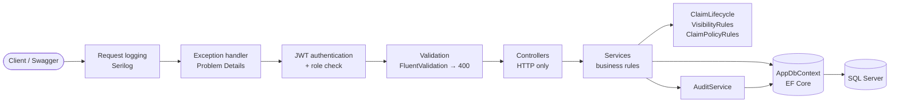
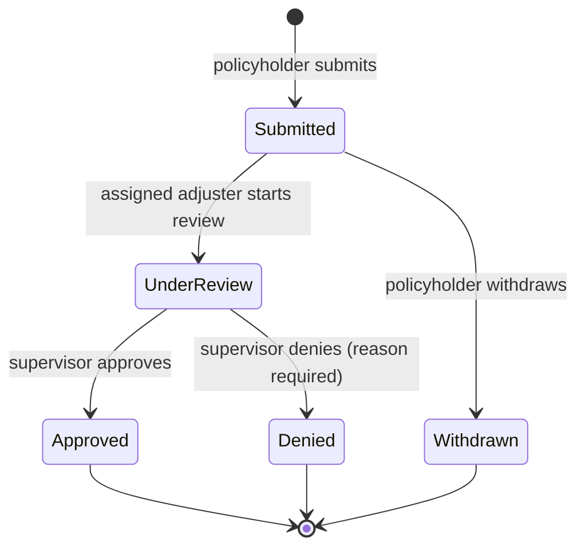

# ClaimTrack

A backend REST API for processing insurance claims. Policyholders file claims against their
policies, adjusters review them, and supervisors make the final decision. Every change is
recorded in an audit log that can't be edited.

Built with **.NET 10, ASP.NET Core, Entity Framework Core, and SQL Server**, as a portfolio
project focused on the things enterprise teams care about: security, business rules,
auditability, and tests.

## Highlights

- **JWT login with three roles** (Policyholder, Adjuster, Supervisor), and a **secure-by-default**
  API: every endpoint needs a token unless it's explicitly public, and a test fails if that changes.
- **Row-level access control.** Each user only sees their own data. The filter runs inside the
  SQL query, and anything you can't see returns **404, not 403**, so the API never confirms it exists.
- **The claim workflow is a state machine.** Allowed status changes are data, checked on every
  action; anything else is rejected with 409. One test checks all 25 combinations.
- **An append-only audit trail**, written in the **same database transaction** as each change,
  so a change can't happen without its history (and the history can't be rewritten).
- **458 automated tests**, including integration tests against a **real SQL Server** in a
  throwaway container (98.5% line coverage). Every business rule is traced to its tests.
- **Production habits:** rate-limited login (password guessing is slowed to 5 tries a minute),
  health checks, structured JSON logging that never logs tokens, RFC 7807 error responses,
  secrets kept out of source control, and a hardened, non-root container image.
- **One command to run:** `docker compose up` starts SQL Server and the API, applies migrations,
  and loads demo data.

## Quick start (Docker only)

You only need [Docker Desktop](https://www.docker.com/products/docker-desktop/) running.

1. Copy `.env.example` to `.env` and replace the three values (`.env` is git-ignored).
2. Run:

   ```bash
   docker compose up --build
   ```

3. Open **http://localhost:8080/swagger**, call `POST /api/auth/login` with a demo account below
   and your `DEMO_PASSWORD`, click **Authorize**, and paste the `accessToken`.

| Demo account | Role | Sees |
|---|---|---|
| `supervisor@claimtrack.test` | Supervisor | everything |
| `adjuster1@claimtrack.test` | Adjuster | 3 claims assigned to them |
| `adjuster2@claimtrack.test` | Adjuster | 4 claims assigned to them |
| `alex.martin@claimtrack.test` | Policyholder | 2 policies, 4 claims |
| `priya.singh@claimtrack.test` | Policyholder | 2 policies, 5 claims |
| `tom.wilson@claimtrack.test` | Policyholder | 1 expired policy, 1 claim |

The demo data covers every claim status, with a full history for each claim. SQL Server isn't
exposed outside Docker. Stop with `docker compose down` (add `-v` to also delete the database).

## Architecture



- **Controllers** only deal with HTTP: they take a request DTO, call one service method, and turn
  its `Result` into a status code.
- **Services** hold every business rule (each commented with its rule ID, e.g. `// BR-05`). The
  rules themselves are small pure classes, so they're unit-tested without a database.
- **EF Core** is used directly, without a repository layer: `DbContext` already is a repository
  and unit of work. One `SaveChanges` saves a change and its audit entry together.
- One API project with folders (`Controllers`, `Services`, `Data`, `Dtos`, `Validators`, …)
  instead of several projects: the same separation, with less ceremony for this size.

### Claim lifecycle



A supervisor can assign or reassign an adjuster while a claim is `Submitted` or `UnderReview`;
assigning doesn't change the status. The adjuster adds a recommendation (Approve/Deny, with
notes) before the supervisor can decide. Claims are never deleted.

### Who can do what

| | Policyholder | Adjuster | Supervisor |
|---|---|---|---|
| See policies | their own | those behind their assigned claims | all |
| See claims and history | their own | assigned to them | all |
| Submit, edit (while `Submitted`), withdraw a claim | ✅ own | | |
| Start review, recommend | | ✅ assigned | |
| Create policies, assign claims, approve/deny | | | ✅ |

### Business rules

Code comments and tests refer to these IDs (e.g. `// BR-05`).

| ID | Rule |
|---|---|
| BR-01 | The claimed amount is more than 0 and no more than the policy's coverage limit. |
| BR-02 | The incident date is within the policy's start and end dates, and not in the future. |
| BR-03 | A policyholder can only claim against their own policy, active on the incident date. |
| BR-04 | Only supervisors assign claims, and only to users with the Adjuster role. |
| BR-05 | Status changes follow the lifecycle above; anything else is 409 Conflict. |
| BR-06 | Denying a claim needs a reason of at least 10 characters. |
| BR-07 | Every submission, edit, assignment, recommendation, document upload, and status change writes an audit entry in the same transaction. An edit's entry lists each changed field's old and new value. |
| BR-08 | Audit entries are append-only: no endpoint changes or deletes them. |
| BR-09 | Users only see what their role allows; anything else is 404, not 403, so its existence isn't revealed. |
| BR-10 | Policy and claim numbers are generated by the system and unique. |
| BR-11 | Emails are unique (ignoring case); passwords are 8+ characters and stored only as hashes. |
| BR-12 | Claims are never deleted; a policyholder withdraws instead. |

## Walkthrough: one claim's whole life

These are real requests and (trimmed) responses from the Docker setup above. They use `curl`
and [`jq`](https://jqlang.github.io/jq/); the same requests are in
[ClaimTrack.http](ClaimTrack.http), ready to run in VS Code (REST Client) or Visual Studio.

```bash
API=http://localhost:8080
login() { curl -s $API/api/auth/login -H 'Content-Type: application/json' \
  -d "{\"email\":\"$1\",\"password\":\"$DEMO_PASSWORD\"}" | jq -r .accessToken; }

PRIYA=$(login priya.singh@claimtrack.test)
SUPERVISOR=$(login supervisor@claimtrack.test)
ADJUSTER=$(login adjuster1@claimtrack.test)
```

**1. The policyholder finds her policy and submits a claim.**

```bash
curl -s $API/api/policies -H "Authorization: Bearer $PRIYA"
#  [ { "id": "6660f471-…", "policyNumber": "POL-2026-00003", "coverageType": "Auto",
#      "coverageLimit": 30000.00, "deductible": 750.00, … }, … ]

curl -s $API/api/claims -H "Authorization: Bearer $PRIYA" -H 'Content-Type: application/json' \
  -d '{"policyId":"<policy id>","incidentDate":"2026-11-19",
       "description":"Rear-ended at a red light; rear bumper and trunk damaged.","claimedAmount":2400.00}'
#  201 Created
#  { "id": "0e61aa3f-…", "claimNumber": "CLM-2026-00051", "status": "Submitted",
#    "claimedAmount": 2400, "assignedAdjusterId": null, … }
```

**2. The supervisor looks up the adjusters and assigns the claim.** (`/api/users` is
supervisor-only and returns only ID, name, and role.)

```bash
curl -s "$API/api/users?role=Adjuster" -H "Authorization: Bearer $SUPERVISOR"
#  [ { "id": "f037ae08-…", "fullName": "Jane Doe", "role": "Adjuster" },
#    { "id": "…", "fullName": "Raj Patel", "role": "Adjuster" } ]

curl -s $API/api/claims/<claim id>/assign -H "Authorization: Bearer $SUPERVISOR" \
  -H 'Content-Type: application/json' -d '{"adjusterId":"<adjuster id>"}'
#  { "status": "Submitted", "assignedAdjusterId": "f037ae08-…", … }
```

**3. The adjuster starts the review and recommends.**

```bash
curl -s -X POST $API/api/claims/<claim id>/start-review -H "Authorization: Bearer $ADJUSTER"
#  { "status": "UnderReview", … }

curl -s $API/api/claims/<claim id>/recommendation -H "Authorization: Bearer $ADJUSTER" \
  -H 'Content-Type: application/json' \
  -d '{"recommendation":"Approve","notes":"Repair estimate matches the photos and the police report."}'
#  { "status": "UnderReview", "recommendation": "Approve", "adjusterNotes": "Repair estimate matches …" }
```

**4. The supervisor decides.** (Denying requires a `reason` of at least 10 characters.)

```bash
curl -s $API/api/claims/<claim id>/decision -H "Authorization: Bearer $SUPERVISOR" \
  -H 'Content-Type: application/json' -d '{"decision":"Approve"}'
#  { "claimNumber": "CLM-2026-00051", "status": "Approved", "decidedAt": "2026-11-19T18:11:54.1403513+00:00", … }
```

**5. Anyone involved reads the history** (oldest first; staff names, never emails).

```bash
curl -s $API/api/claims/<claim id>/history -H "Authorization: Bearer $PRIYA"
#  Submitted      —          → Submitted     Priya Singh  (Policyholder)
#  Assigned       "Assigned to Jane Doe"     Sarah Chen   (Supervisor)
#  ReviewStarted  Submitted  → UnderReview   Jane Doe     (Adjuster)
#  Recommended    "Recommended Approve"      Jane Doe     (Adjuster)
#  Approved       UnderReview → Approved     Sarah Chen   (Supervisor)
```

**Lists are paged, filtered, and sorted** (only claims you're allowed to see are returned or counted):

```bash
curl -s "$API/api/claims?status=Approved&sort=-claimedAmount&pageSize=2" -H "Authorization: Bearer $SUPERVISOR"
#  { "items": [ { "claimNumber": "CLM-2026-00007", "claimedAmount": 9500.00, … }, … ],
#    "page": 1, "pageSize": 2, "totalCount": 3, "totalPages": 2 }
```

`sort` can be `submittedAt` (default, newest first), `incidentDate`, `claimedAmount`, or
`claimNumber`, with `-` for descending; `pageSize` is 1–100.

**Overdue claims.** A background job checks at startup and then hourly for claims that have
been `UnderReview` for **14+ days** since the review started, and flags them (`flaggedOverdueAt`).
A supervisor's triage list:

```bash
curl -s "$API/api/claims?overdue=true&status=UnderReview" -H "Authorization: Bearer $SUPERVISOR"
#  { "items": [ { "claimNumber": "CLM-2026-00005", "status": "UnderReview",
#                 "flaggedOverdueAt": "2026-11-20T21:00:36.6080028+00:00", … }, … ], "totalCount": 2, … }
```

The demo data includes two such claims. The flag stays after a decision, as a record that the
claim went overdue; the threshold and interval are under `OverdueClaims` in `appsettings.json`.

**Health checks** need no token, for load balancers and container platforms:

| Endpoint | Checks | Answers |
|---|---|---|
| `GET /health` | the API **and** SQL Server (3-second limit) | `200 Healthy`, or `503 Unhealthy` when the database can't be reached |
| `GET /health/live` | the API process only | `200 Healthy` (a database outage shouldn't trigger a restart) |

The body is only the word `Healthy` or `Unhealthy`; the reason for a failure goes to the logs.

**Rate limits** (sliding one-minute windows, configurable under `RateLimiting` in `appsettings.json`):

| Endpoints | Limit | Counted per |
|---|---|---|
| `POST /api/auth/login`, `/register` | 5 a minute | client IP |
| everything else | 100 a minute | logged-in user (IP if anonymous) |
| `/health`, `/health/live` | none | — |

Going over gives `429 Too Many Requests` with a `Retry-After` header (in seconds).

**Documents** (photos, receipts, reports) can be attached by anyone who can see the claim, while
it isn't final. PDF, PNG, or JPEG only, recognised by the file's own bytes; up to 10 MB each and
20 per claim. Uploads appear in the claim's history; documents are never deleted.

```bash
curl -s $API/api/claims/<claim id>/documents -H "Authorization: Bearer $PRIYA" -F "file=@repair-quote.pdf"
#  201 Created
#  { "id": "8e894448-…", "fileName": "repair-quote.pdf", "contentType": "application/pdf",
#    "sizeBytes": 52, "uploadedByName": "Priya Singh", … }

curl -s $API/api/claims/<claim id>/documents -H "Authorization: Bearer $PRIYA"            # list
curl -s -OJ $API/api/claims/<claim id>/documents/<document id> -H "Authorization: Bearer $PRIYA"   # download
```

A program renamed to `invoice.pdf` gets `400` `"Only PDF, PNG, or JPEG files are allowed."`.
Files are stored under random names the server chooses (a Docker volume in compose), and
downloads are sent as attachments with `X-Content-Type-Options: nosniff`.

**Errors** are always [RFC 7807 Problem Details](https://www.rfc-editor.org/rfc/rfc9457) with a
`traceId` that matches the server's logs:

| Request | Response |
|---|---|
| Withdraw an approved claim | `409` `"Cannot move a claim from Approved to Withdrawn."` |
| `?pageSize=500` | `400` `"errors": { "pageSize": ["'Page Size' must be between 1 and 100. You entered 500."] }` |
| Another policyholder's claim | `404` (not 403: its existence isn't revealed) |
| A supervisor submitting a claim | `403` |
| No token | `401` |
| A 6th login attempt within a minute | `429` `"Too many requests. Wait and try again."` with `Retry-After: 10` |

## Key design decisions

Each one is explained in full, with the trade-off, in the
[decisions log](docs/architecture.md#7-decisions-log).

| Decision | Why |
|---|---|
| **404 instead of 403** for other users' data, filtered **in the SQL query** | Doesn't reveal that a record exists, and other users' rows are never even loaded (OWASP "Broken Access Control") |
| **Workflow rules as data** (`ClaimLifecycle`) | The requirements' transition table and the code match line for line, and one test checks every combination |
| **Audit entry saved in the same `SaveChanges`** as the change; `DbContext` refuses to modify or delete entries | One transaction: both are saved or neither is. A test makes the audit write fail and proves the change is rolled back |
| **`Result<T>` for expected failures**, exceptions only for bugs | Not-found and rule violations are normal outcomes, mapped to HTTP in one place; a 500 always means a real bug |
| **SQL Server sequences** for `POL-2026-00001` / `CLM-…` numbers | Unique under concurrent requests (unlike "max + 1"); gaps are accepted |
| **Real SQL Server in integration tests** (Testcontainers), no in-memory database or mocked `DbContext` | Tests exercise real constraints, sequences, transactions, and SQL translation |
| **Validation split:** input checks in FluentValidation (400), rules needing data in services (422) | Validators stay database-free; business rules live in one layer |
| **One role per account** | Separation of duties: a supervisor can never approve their own claim |
| **Secrets never in source control** | `dotnet user-secrets` locally, environment variables / `.env` in Docker; the API refuses to start without a valid signing key |

## Testing

```bash
dotnet test
```

- **Unit tests** (`tests/ClaimTrack.UnitTests`, 264): validators, business rules, the state
  machine, visibility filters, token creation, mappings. No database.
- **Integration tests** (`tests/ClaimTrack.IntegrationTests`, 194): the real API over HTTP via
  `WebApplicationFactory`, against SQL Server started by
  [Testcontainers](https://dotnet.testcontainers.org/) for the run. **Docker must be running.**
  They cover every endpoint (a success and a failure each), every role restriction, the audit
  transaction, logging (no tokens in logs), and the demo data replayed against the workflow rules.
- **[Test matrix](docs/test-matrix.md):** which tests prove each business rule (BR-01 to BR-12)
  and each endpoint, plus the few lines deliberately left uncovered and why.

<details>
<summary>Coverage report</summary>

```bash
dotnet test --collect:"XPlat Code Coverage" --results-directory TestResults/latest
dotnet reportgenerator "-reports:TestResults/latest/**/coverage.cobertura.xml" "-targetdir:TestResults/latest/report" "-reporttypes:Html" "-classfilters:-ClaimTrack.Api.Data.Migrations.*;-Microsoft.AspNetCore.OpenApi.Generated*;-System.Runtime.CompilerServices*;-System.Text.RegularExpressions.Generated*"
```

Open `TestResults/latest/report/index.html`. Delete `TestResults/latest` before running it again
so old results aren't mixed in. (`dotnet tool restore` installs `reportgenerator`.)
</details>

## Running it locally (for development)

You need the [.NET 10 SDK](https://dotnet.microsoft.com/download/dotnet/10.0) and Docker Desktop.
Commands work in PowerShell and bash, from the repository root. Choose your own strong SQL Server
password in place of `<YourStrong!Passw0rd>`.

**1. Start SQL Server** (data is kept in the `claimtrack-sql-data` volume; after a reboot, run
`docker start claimtrack-sql`):

```bash
docker run -d --name claimtrack-sql -e 'ACCEPT_EULA=Y' -e 'MSSQL_SA_PASSWORD=<YourStrong!Passw0rd>' -p 1433:1433 -v claimtrack-sql-data:/var/opt/mssql mcr.microsoft.com/mssql/server:2022-latest
```

**2. Store the secrets** in .NET user-secrets (outside the repository):

```bash
dotnet user-secrets set 'ConnectionStrings:ClaimTrack' 'Server=localhost,1433;Database=ClaimTrack;User Id=sa;Password=<YourStrong!Passw0rd>;Encrypt=True;TrustServerCertificate=True' --project src/ClaimTrack.Api
dotnet user-secrets set 'Jwt:SigningKey' '<a random string of at least 32 characters>' --project src/ClaimTrack.Api
dotnet user-secrets set 'Seed:DemoPassword' '<at least 8 characters>' --project src/ClaimTrack.Api
```

For a random key in PowerShell 7 (`pwsh`):
`[Convert]::ToBase64String([System.Security.Cryptography.RandomNumberGenerator]::GetBytes(64))`.
Without `Seed:DemoPassword`, the demo data is skipped with a warning.

**3. Create the database and run:**

```bash
dotnet tool restore
dotnet ef database update --project src/ClaimTrack.Api
dotnet run --project src/ClaimTrack.Api
```

Then open **http://localhost:5016/swagger**. In Development, the API adds the demo data on
startup and logs readable lines (other environments log one JSON object per line).

<details>
<summary>Running only the API image (without compose)</summary>

The [Dockerfile](Dockerfile) is a multi-stage build onto an Ubuntu "chiseled" runtime (no shell,
no package manager) running as a non-root user. Secrets are passed at run time (`__` stands for
`:` in .NET configuration keys); inside the container, your PC is `host.docker.internal`.

```bash
docker build -t claimtrack-api .
docker run --rm -p 8080:8080 \
  -e 'ConnectionStrings__ClaimTrack=Server=host.docker.internal,1433;Database=ClaimTrack;User Id=sa;Password=<YourStrong!Passw0rd>;Encrypt=True;TrustServerCertificate=True' \
  -e 'Jwt__SigningKey=<your signing key>' \
  claimtrack-api
```

This runs in Production mode: no Swagger, no demo data, JSON logs.
</details>

## Known limitations

Deliberate trade-offs for a portfolio-sized project, and what a production system would do:

- **The user list isn't paged.** Fine for a handful of staff and demo customers; a real insurer
  with thousands of policyholders would add search and paging to `GET /api/users`.
- **Migrations run on startup** (only when enabled, as in compose). Production would run them as
  a separate deployment step so the app never needs permission to change the schema.
- **Compose uses SQL Server's `sa` account.** Production would use a login limited to reading and
  writing data.
- **Two rare race conditions** (deleting a policy while a claim is filed at the same instant;
  registering the same email twice at once) return 500 instead of 409. The database constraints
  still keep the data correct.
- **Rate limits are per IP, not per account.** An attacker spreading guesses across many IPs isn't
  slowed; the next layer would be account lockout after repeated failed logins. Behind a load
  balancer, the API would also need ASP.NET Core's forwarded-headers support set to trust only
  that proxy, or every client would share the proxy's IP. Limits are kept in memory, so with
  several API copies each would count separately (a shared store such as Redis fixes that).
- **No Docker health check for the API container.** The hardened image has no shell or `curl` to
  run a probe from inside; platforms like Azure or Kubernetes call `/health` from outside instead.
- **Offset paging.** Fine at this scale; very large tables would use keyset paging.
- **Uploads aren't scanned for malware.** A file is checked to really be a PDF/PNG/JPEG, but a
  harmful PDF would still be stored; production would scan uploads (e.g. Microsoft Defender for
  Storage or ClamAV). Files are on local disk, so several API copies would need shared storage;
  `IDocumentStorage` is the seam for Azure Blob Storage.
- **The overdue job runs inside each API copy.** Its update is idempotent, so several copies can't
  double-flag, but they'd all do the work; a large system would use a single scheduler (e.g.
  Hangfire, Quartz, or an Azure Function). Flagging isn't in the audit trail, because every audit
  entry needs a real user as its actor and the job isn't one.

## Roadmap

Phase 3 is complete, and Phase 4 (optional extras) has added health checks, rate limiting, the
overdue-claims background job, and document uploads. Planned next: an Angular front end, and
deploying to Azure (App Service + Azure SQL + Blob Storage).

## Project docs

- [Architecture](docs/architecture.md): layers, coding standards, decisions log
- [Test matrix](docs/test-matrix.md): which tests prove each business rule and endpoint
